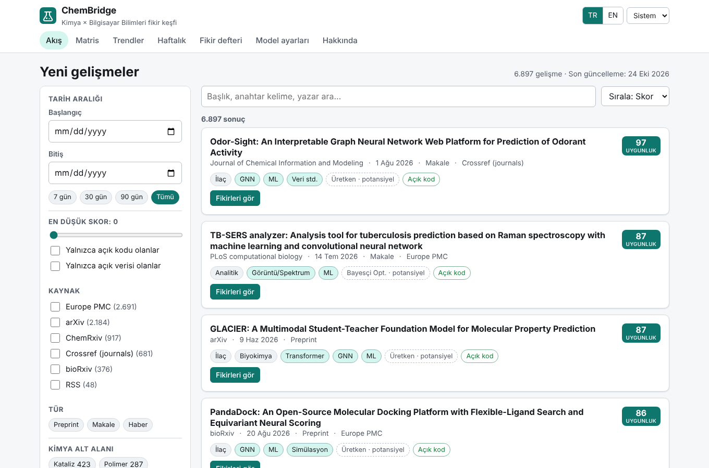
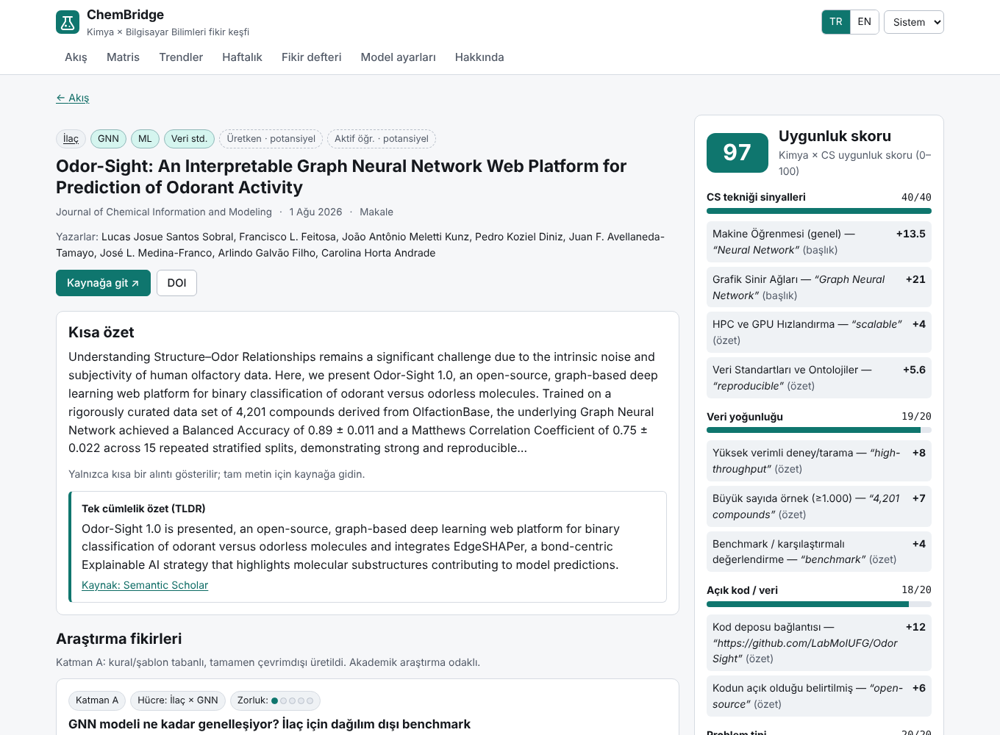
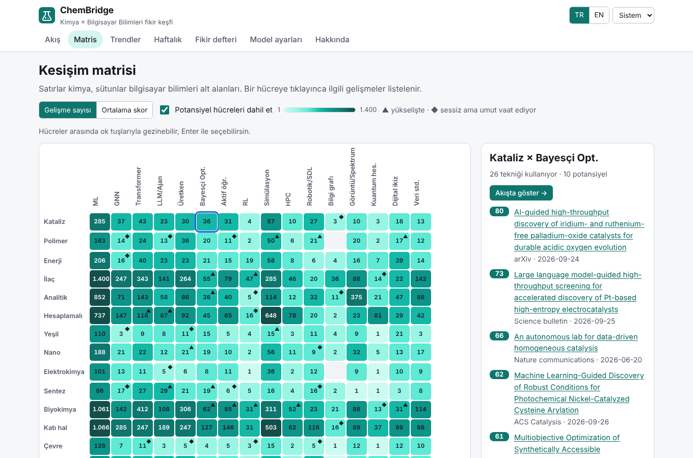
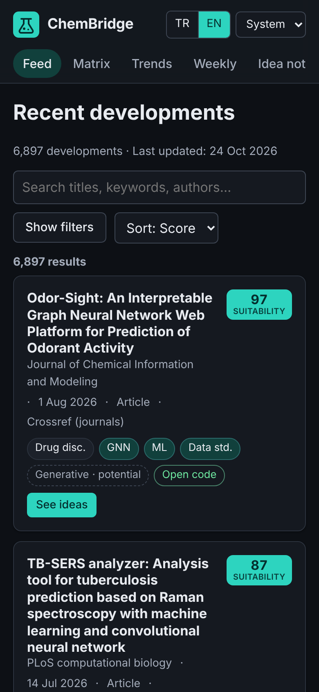
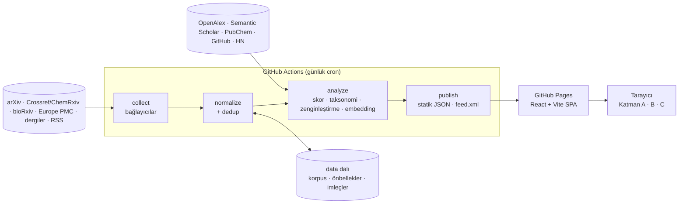

# ChemBridge — Kimya × Bilgisayar Bilimleri fikir keşfi

ChemBridge, kimyadaki yeni preprint, makale ve haberleri her gün otomatik toplar. Bunların
içinden **bilgisayar bilimleriyle birleşmeye müsait** olanları açıklanabilir bir skorla öne çıkarır,
kimya × CS kesişim matrisine yerleştirir ve her biri için **akademik araştırma fikirleri** önerir.

- **Sıfır maliyet:** GitHub Actions + statik dosyalar + GitHub Pages. Ücretli API, ücretli LLM ya da
  sunucu yok. Kredi kartı isteyen hiçbir servis varsayılan yolda değil.
- **Açıklanabilir:** Skordaki her puan bir kurala, eşleşen metne ve alana (başlık/özet/meta) bağlı.
- **Çevrimdışı fikirler:** Katman A şablon tabanlıdır ve tarayıcıda çalışır. İsteğe bağlı olarak
  Katman B (tarayıcıda WebLLM veya yerel Ollama) ya da Katman C (kendi ücretsiz anahtarın) kullanılabilir.

| Akış                               | Detay ve skor açıklaması            | Kesişim matrisi                        |
| ---------------------------------- | ----------------------------------- | -------------------------------------- |
|  |  |  |

Mobil ve koyu tema: 

## Mimari



| Paket                                    | İçerik                                                                                                                                                                                                                                        |
| ---------------------------------------- | --------------------------------------------------------------------------------------------------------------------------------------------------------------------------------------------------------------------------------------------- |
| [`packages/core`](packages/core)         | Domain şeması (Zod → JSON Schema), kimlik normalizasyonu, taksonomi eşleme, skor motoru, Katman A fikir üretimi, trendler, benzerlik. Kurallar [`rules/*.json`](packages/core/rules) dosyalarında. Node ve tarayıcıda çalışır.                |
| [`packages/pipeline`](packages/pipeline) | HTTP politikası (zaman aşımı, yeniden deneme, üstel geri çekilme, `Retry-After`, host başına hız sınırı, ETag/Last-Modified, robots.txt, bot korumasını tanıma), bağlayıcılar, dedup, zenginleştirme, embedding (Transformers.js), yayınlama. |
| [`apps/web`](apps/web)                   | React 18 + TypeScript + Vite. Akış/filtreler, detay, ısı haritası, trendler, haftalık özet, fikir defteri, model ayarları. TR/EN arayüz, açık/koyu tema, klavye ile kullanılabilir.                                                           |

Ayrıntılar ve Seçenek A/B karşılaştırması: [`docs/ARCHITECTURE.md`](docs/ARCHITECTURE.md).

## Veri kaynakları

Hepsi anahtarsız ya da ücretsiz anahtarla çalışır; uç noktalar 2026-10-24'te canlı istekle doğrulandı.
Tam tablo (limitler, kullanım şartları, durum): [`docs/SOURCES.md`](docs/SOURCES.md).

| Kaynak                     | Yol                                             | Not                                                                                                                                                       |
| -------------------------- | ----------------------------------------------- | --------------------------------------------------------------------------------------------------------------------------------------------------------- |
| arXiv                      | API (Atom)                                      | `physics.chem-ph`, `cond-mat.mtrl-sci`, `q-bio.BM` + kimya terimli `cs.LG/AI/CE`; çapraz listeleme sinyali                                                |
| ChemRxiv                   | Crossref (önek `10.26434`)                      | Engage API Cloudflare korumalı; korumayı aşmıyoruz                                                                                                        |
| bioRxiv                    | API                                             | biyokimya, biyofizik, sentetik biyoloji, farmakoloji; medRxiv yapılandırılabilir (varsayılan kapalı)                                                      |
| Europe PMC                 | REST                                            | ML × kimya sorgusu                                                                                                                                        |
| ACS, RSC, Nature dergileri | Crossref (ISSN)                                 | JACS, JCIM, JCTC, ACS Catal., Chem. Mater., ACS Cent. Sci., Digital Discovery, Chem. Sci., Nat. Chem., Nat. Mater., npj Comput. Mater., Nat. Comput. Sci. |
| Haber/dergi akışları       | RSS/Atom                                        | Nature (4 akış), C&EN, Phys.org, ScienceDaily                                                                                                             |
| Zenginleştirme             | OpenAlex, Semantic Scholar, PubChem, GitHub, HN | Konu, TLDR, madde adları, açık kaynak ve topluluk sinyali                                                                                                 |

## Hızlı başlangıç (yerel)

Gereksinim: Node ≥ 22.12, pnpm 10.

```bash
pnpm install
pnpm pipeline run --days=14     # son 14 günü topla, analiz et, yayınla (.data/ altına)
pnpm dev                        # http://localhost:5173 — .data/public, /data altından sunulur
```

Tam 180 günlük geriye dönük çekim için `pnpm pipeline run` (ilk çalışmada ≈15–25 dk; bioRxiv sayfa
başına 30 kayıt döndürür). Sonraki çalışmalar imleçlerden 3 gün örtüşmeyle devam eder.

> Bir HTTP proxy arkasındaysan Node'un `fetch`'i proxy'yi kendiliğinden kullanmaz:
> `NODE_USE_ENV_PROXY=1 pnpm pipeline run`.

| Komut                                              | Ne yapar                                                                |
| -------------------------------------------------- | ----------------------------------------------------------------------- |
| `pnpm pipeline collect [--sources=a,b] [--days=N]` | Kaynakları çeker, normalize eder, korpusla birleştirir                  |
| `pnpm pipeline analyze`                            | Skor, taksonomi, zenginleştirme ve embedding                            |
| `pnpm pipeline publish [--out=DIR]`                | Statik JSON + `feed.xml` (ağ kullanmaz)                                 |
| `pnpm pipeline run [--skip-collect]`               | Üçü birden (günlük iş)                                                  |
| `pnpm pipeline probe`                              | Her uç noktaya tek bir canlı istek atar ve sonucu tablo olarak raporlar |
| `pnpm pipeline fixtures:record`                    | Probe yanıtlarını kırpıp test fixture'ı olarak kaydeder                 |
| `pnpm pipeline stats`                              | Korpus istatistikleri                                                   |
| `pnpm check`                                       | lint + typecheck + test + build                                         |
| `pnpm schema:export`                               | Domain modelini JSON Schema olarak `packages/core/schema/` altına yazar |

Ortam değişkenleri: `CHEMBRIDGE_DATA_DIR` (varsayılan `.data`), `CONTACT_EMAIL` (Crossref/OpenAlex
"polite pool" ve User-Agent için; kodda e-posta yok), `SITE_URL` (RSS bağlantıları), isteğe bağlı
`OPENALEX_API_KEY`, `S2_API_KEY`, `GITHUB_TOKEN`, `CHEMBRIDGE_EMBEDDINGS=tfidf` (model indirmeden
çalışma).

## Skor, taksonomi, fikirler

**Uygunluk skoru (0–100)** dört bileşenden oluşur: CS tekniği sinyalleri (≤40; GNN, transformer,
BO, aktif öğrenme, LLM ajanı, robotik/SDL, kuantum, dijital ikiz… ve arXiv çapraz listeleme),
veri yoğunluğu (≤20), açık kod/veri (≤20) ve problem tipi (≤20). Cezalar düzeltme/geri çekme
duyurularını ve derlemeleri aşağı çeker. Detay sayfası her puanın gerekçesini gösterir.

**Taksonomi:** 14 kimya alt alanı × 16 CS alt alanı. Bir gelişme henüz hiçbir CS tekniği
kullanmıyorsa, sinyallerine göre "potansiyel" hücreler önerilir (ör. yüksek verimli tarama →
aktif öğrenme). Trendler sayfası yükselen hücreleri ve "sessiz ama umut vaat eden" hücreleri (az
yayın, yüksek ortalama skor) gösterir.

**Fikirler:** Katman A, hücreye göre 17 akademik şablondan en uygun olanları seçer. Her fikirde
araştırma sorusu, yöntem, değerlendirme, zorluk, gerekli açık veri setleri, teknoloji yığını, olası
yayın yerleri, veriye dayalı "neden şimdi" gerekçeleri ve benzer çalışmalar bulunur. Katman B/C
aynı bilgileri bir dil modeline verir; çıktılar doğrulanmamış diye işaretlenir.

## Yayına alma (GitHub Pages, ücretsiz)

1. Kodu bir **public** GitHub deposuna it.
2. Settings → Pages → Source: **GitHub Actions**.
3. Settings → Secrets and variables → Actions → **Variables**:
   - `CONTACT_EMAIL`: sana ait bir adres (Crossref polite pool; `User-Agent`'ta görünür),
   - `SITE_URL`: `https://<kullanıcı>.github.io/<depo>`.
4. (İsteğe bağlı) **Secrets**: `OPENALEX_API_KEY`, `S2_API_KEY` (ikisi de ücretsiz).
5. Actions → **Update data & deploy** → _Run workflow_. İlk çalışma 180 günü geriye doğru çeker,
   `data` dalını oluşturur ve siteyi yayınlar. Sonra her gün 04:23 UTC'de kendiliğinden çalışır.

[`ci.yml`](.github/workflows/ci.yml) her push ve PR'da lint, format, typecheck, test ve build çalıştırır.
Private depo kullanacaksan Pages ücretli plan ister; `apps/web/dist` klasörü Cloudflare Pages'e de
aynen yüklenebilir.

## Yeni kaynak eklemek

[`docs/ADDING_A_SOURCE.md`](docs/ADDING_A_SOURCE.md). Bir RSS akışı ya da Crossref'teki bir dergi
yalnızca yapılandırma ister; yeni bir API için bağlayıcı, istek politikası, fixture ve test adımları
orada anlatılıyor.

## Bilinen sınırlamalar

- **Semantic Scholar:** Anahtarsız istemciler herkesle paylaşılan bir havuzu kullanır ve geliştirme
  sırasında sürekli `429` döndü. Bu durumda devre kesici o çalışmada S2'yi atlar, TLDR'ler boş kalır.
  Ücretsiz bir `S2_API_KEY` bunu çözer.
- **GitHub Search:** Geliştirme ortamından test edilemedi (oturum depo kapsamlıydı). Actions'ta
  `GITHUB_TOKEN` ile çalışması bekleniyor; hata verirse kendi kendini kapatıyor.
- **ChemRxiv:** Crossref kayıtlarında lisans alanı bulunmuyor, bu yüzden özetlerden yalnızca kısa
  alıntı saklanıyor.
- **RSS:** Akışlar yalnızca son öğeleri verir, geriye dönük çekim yapılamaz. Dergiler için geçmiş
  veri Crossref'ten geliyor.
- **Katman B:** WebLLM, WebGPU destekli bir tarayıcı ve bir kerelik model indirmesi
  (≈0,9–1,6 GB) gerektirir. Küçük modeller bazen bozuk JSON üretir; bu durumda ham yanıt gösterilir.
- **Seçenek B** (Spring Boot + PostgreSQL) uygulanmadı; paylaşılabilir parçalar (JSON kural
  dosyaları, JSON Schema) hazır. Bkz. `docs/ARCHITECTURE.md`.

## Lisans ve atıf

Kod MIT lisanslıdır ([`LICENSE`](LICENSE)). Toplanan içerik kaynaklarının şartlarına tabidir. Site
yalnızca meta veri ve en fazla 600 karakterlik özet alıntısı gösterir, tam metin kopyalamaz ve her
gelişmeyi kaynağına bağlar. arXiv meta verisi CC0'dır. Semantic Scholar verisi
[semanticscholar.org](https://www.semanticscholar.org/) atfıyla gösterilir.
