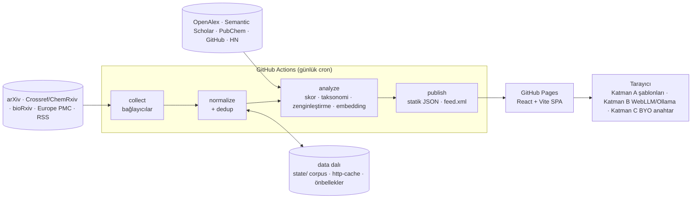

# Mimari karar kaydı

## Karar: Seçenek A — sunucusuz, statik (varsayılan ve uygulanan)

Veri toplama, skorlama ve yayınlama GitHub Actions'ta günlük cron ile çalışır. Çıktılar statik JSON
dosyalarıdır ve React önyüzüyle birlikte GitHub Pages'e (veya Cloudflare Pages'e) yüklenir. Çalışan
bir sunucu, veritabanı ya da ücretli API yoktur.



### Paketler

| Paket               | Görev                                                                                                                                                                                    | Çalıştığı yer     |
| ------------------- | ---------------------------------------------------------------------------------------------------------------------------------------------------------------------------------------- | ----------------- |
| `packages/core`     | Domain şeması (Zod → JSON Schema), kimlik normalizasyonu, taksonomi, skor motoru, Katman A fikir üretimi, trend hesapları, TF-IDF benzerliği. Kurallar `rules/*.json` veri dosyalarında. | Node + tarayıcı   |
| `packages/pipeline` | HTTP politikası (zaman aşımı, yeniden deneme, backoff, hız sınırı, ETag/Last-Modified, robots.txt), bağlayıcılar, dedup, zenginleştirme, embedding, yayınlama.                           | Node 22 (Actions) |
| `apps/web`          | React 18 + TypeScript + Vite SPA; HashRouter, MiniSearch, ısı haritası, trendler, fikir defteri, TR/EN, tema, Katman B/C.                                                                | Tarayıcı          |

### Veri düzeni

```
<DATA_DIR>/                         # Actions'ta `data` dalının çalışma kopyası, yerelde .data/
  state/
    corpus/YYYY/MM/DD.jsonl         # normalize edilmiş kayıtlar (yayın gününe göre bölümlenmiş)
    cursors.json                    # kaynak başına son başarılı pencere (artımlı toplama)
    source-status.json              # kaynak başına son çalışma raporu (meta.json'a girer)
    http-cache.json                 # ETag / Last-Modified (yalnızca başarılı kaynaklar için kaydedilir)
    robots-cache.json               # robots.txt, 24 saat
    enrich/*.json                   # OpenAlex, Semantic Scholar, PubChem, GitHub, HN önbellekleri
    embeddings-<model>.jsonl        # int8 nicemlenmiş vektörler + metin özeti (değişmeyen yeniden hesaplanmaz)
    trend-history.json              # tamamlanmış haftaların hücre sayımları (saklama penceresinden bağımsız)
    last-collect.json, last-enrichment.json
  raw/YYYY-MM-DD/<kaynak>-NNN.json.gz   # ham yanıtlar, gzip (son 7 gün; ayrıca 14 günlük Actions artifact'ı)
  public/                           # web uygulamasının /data/ altına kopyalanan yayın dosyaları
    meta.json index.json search.json items/NN.json trends.json weekly/*.json feed.xml
```

Skor, taksonomi ve hücreler her çalışmada korpustan yeniden hesaplanır (32 bin kayıt ≈ 20 sn), bu
yüzden kural dosyalarındaki bir değişiklik bir sonraki yayında tüm geçmişe uygulanır. Ağ gerektiren
zenginleştirme sonuçları ise önbellekte tutulur.

`data` dalı tek bir commit olarak tutulur (her çalışma `--amend` + `--force`), böylece depo
büyümez. Saklama penceresinden taşan geçmiş, yalnızca toplu sayımlar olarak `trend-history.json`
içinde kalır.

### Neden bu tasarım

- **Maliyet sıfır:** Public depolarda Actions dakikaları ve Pages ücretsiz. Private depo için Pages
  ücretli plan ister; o durumda aynı `dist/` klasörü Cloudflare Pages'e yüklenebilir.
- **Paylaşılabilir domain:** Skor ağırlıkları, taksonomi ve fikir şablonları kodda değil JSON
  dosyalarında; şema JSON Schema olarak dışa aktarılıyor. Başka bir dildeki backend aynı dosyaları
  okuyup aynı sonucu üretebilir.
- **Açıklanabilirlik:** Skorun her puanı bir kurala, eşleşen metne ve alana (başlık/özet/meta)
  bağlanır; arayüz bunu madde madde gösterir.

## Seçenek B — klasik backend (uygulanmadı, karşılaştırma)

Java 21 + Spring Boot 3 (scheduler, bağlayıcılar, skor), PostgreSQL, Redis, Docker Compose; önyüz aynı
React uygulaması.

| Ölçüt               | A: Actions + Pages                                      | B: Spring Boot + PostgreSQL + Redis                                                                                                                                                                                                             |
| ------------------- | ------------------------------------------------------- | ----------------------------------------------------------------------------------------------------------------------------------------------------------------------------------------------------------------------------------------------- |
| Para maliyeti       | 0 (public depo)                                         | Kart istemeyen, kalıcı ve 7/24 açık JVM + PostgreSQL barındırma pratikte yok: ücretsiz katmanlar ya uykuya geçiyor, ya veritabanını belirli süre sonra siliyor, ya da kart istiyor. Gerçekçi ücretsiz kullanım: kendi makinende Docker Compose. |
| Bakım               | Cron logları; sunucu yok                                | İşletim sistemi/JVM güncellemeleri, veritabanı yedekleri, izleme                                                                                                                                                                                |
| Tazelik             | Günde bir (manuel tetikleme mümkün)                     | Dakika düzeyinde mümkün                                                                                                                                                                                                                         |
| Arama               | Tarayıcıda MiniSearch (on binlerce kayıtta yeterli)     | Sunucu tarafı tam metin arama                                                                                                                                                                                                                   |
| Ölçek sınırı        | Statik JSON boyutu (yayın eşikleriyle kontrol ediliyor) | Veritabanı kapasitesi                                                                                                                                                                                                                           |
| Paylaşılan parçalar | `rules/*.json`, `schema/*.schema.json`, React önyüzü    | Aynı dosyalar Java tarafından okunur                                                                                                                                                                                                            |

B'ye geçiş gerektiğinde: `packages/core/schema/*.schema.json` → Java kayıt sınıfları
(jsonschema2pojo vb.), `rules/*.json` → aynı kural motorunun Java uygulaması; önyüz `/data/*.json`
yerine REST uç noktalarından okur (aynı JSON biçimi).

## Fikir üretimi katmanları

| Katman              | Nerede                                                          | Gereksinim                           | Not                                                          |
| ------------------- | --------------------------------------------------------------- | ------------------------------------ | ------------------------------------------------------------ |
| A — kural/şablon    | Tarayıcı (ve haftalık özet için pipeline)                       | Yok                                  | `rules/ideas.json`; akademik araştırma odaklı; deterministik |
| B — yerel model     | Tarayıcıda WebLLM (WebGPU) veya kullanıcının makinesinde Ollama | WebGPU'lu tarayıcı veya yerel Ollama | Model kullanıcının cihazında çalışır; sunucu maliyeti yok    |
| C — kendi anahtarın | Tarayıcıdan doğrudan sağlayıcıya                                | Kullanıcının ücretsiz anahtarı       | Anahtar yalnızca `localStorage`'da; sunucuya hiç gitmez      |

Embedding'ler (ilgili gelişmeler ve konu kümeleri) pipeline'da Transformers.js ile
`Xenova/all-MiniLM-L6-v2` modeliyle hesaplanır; model indirilemezse TF-IDF'e düşülür.
